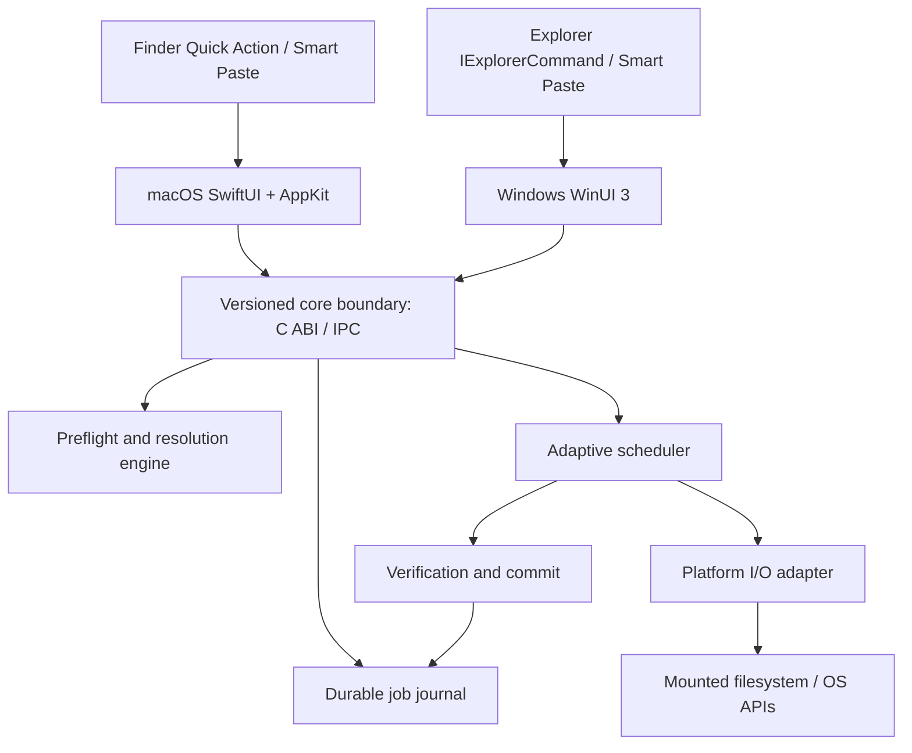

# 02 — Architecture

## Cross-platform split

Use **Rust** for common workload classification, task graph, scheduling, recovery, error taxonomy, and verification. Keep platform adapters responsible for filesystem probing, metadata preservation, atomic operations and OS I/O APIs. A SwiftUI/AppKit shell ships first; a separate WinUI 3 app later.

**Boundary choice:** begin with a versioned JSON-lines CLI/IPC prototype (easy to test and audit). Before GUI alpha, choose either a stable C ABI or authenticated per-user IPC with clear cancellation/event semantics. Do not prematurely promise a particular FFI implementation.

## Components

1. **Job controller:** Owns job state, pause/resume/cancel, lifecycle and priorities.
2. **Scanner:** Efficient local metadata walk; incremental plans; avoids contents hashing during the fast preflight unless requested.
3. **Capability probe:** Runtime detects filesystem/mount read-write mode, clone support, case behavior, file-size bounds, free space, name/path limits and supported metadata operations. Unknowns are first-class values, not false assumptions.
4. **Resolution engine:** Generates structured, ranked `Issue` and `Remedy` objects with safety classification.
5. **Planner:** Determines rename vs clone vs sequential vs concurrent file workers, applies metadata policies and fallback.
6. **Scheduler:** Per-device backpressure, bounded workers, adaptive tuning, foreground job priority, later job queue.
7. **I/O backend:** Streaming copy with cancellation and partial progress, OS APIs where advantageous, destination staging, error translations.
8. **Verification:** Byte-count + size/metadata checks; optional cryptographic hashes, with strict vs balanced profiles. Require robust verification before source deletion on move, as specified by the move policy.
9. **Journal:** Persistent job manifest and per-item state with durable checkpoints. Supports safe recovery without trusting stale partial files.
10. **Native UI/extension:** Operates through stable async commands/events, never runs heavy scans on UI thread.

## Scheduler policy, not hard-coded file extensions

Inputs: size distribution, item count, source and destination physical topology, driver/mount capabilities, current measured rate and latency, device removability, preservation requirements.

Example initial policy (to benchmark and revise):

- Same-volume rename for moves where valid; APFS copy-on-write clone for eligible same-volume copies.
- One giant file: sequential streaming, one writer; only consider multi-stream intra-file I/O after controlled evidence.
- Many medium files: start with 4 workers and tune within a validated 1–16 bound; use per-device queue depths and latency feedback.
- Many tiny files: concurrent traversal/metadata and capped worker pool; avoid contention from unbounded creation.
- Source and target on same physical drive: often reduce workers to avoid head-of-line contention; detect volume vs physical-device distinction.
- Changing workload mix: adapt gradually, hysteresis and ceiling; never chase noisy instantaneous MB/s figures.

**Caution:** worker count is not an independently monotonic speed knob. Device-specific gains must be empirically established.

## I/O algorithm, per file

1. Validate source identity and destination capabilities; capture source snapshot metadata.
2. Resolve symlinks, bundles, hard links and collision policy *without following unexpected links*.
3. Create a private, noncolliding partial destination on the destination volume; reserve/check capacity.
4. Copy bytes using a selected backend; update journal checkpoints.
5. Flush data as required; preserve supported metadata; validate source unchanged.
6. Verify mandatory outcomes; record metadata warnings; atomically rename/commit where supported and safe.
7. On cross-volume move, remove the source **only** after destination commit/verification, with explicit confirmation and race rechecks.

Directory commits require careful treatment: a tree is not automatically one atomic transaction. Handle partial-tree recovery and per-item visibility deliberately.

## Platform adapters

### macOS

- Foundation `FileManager` for ordinary operations, volume capabilities via URL resource keys; `copyfile`/`clonefile` and platform APIs when appropriate.
- NSFileCoordinator when required for coordinated/document-provider file operations; app sandbox and security-scoped bookmarks only if distribution model uses sandboxing.
- APFS clone is a capability, **not** a guarantee based solely on the filesystem name.
- Extended attributes, resource forks, Finder information, modes, timestamps and symlinks need explicit supported preservation policy.

### Windows

- `GetVolumeInformation`, `GetDiskFreeSpaceEx`, `GetFileInformationByHandleEx` and volume identification; long paths, reparse points, ACLs, streams.
- `CopyFile2` / other native APIs when useful. Do not assume they implement every Rust-level recovery requirement by default.
- Drive letter is not a durable volume identity; query real volume identifiers.

## State machine

`created → scanning → planning → needs_resolution | ready → running ↔ paused → verifying → committing → completed`

Any state may go to `failed` or `cancelled`; `interrupted` must be distinguishable from user cancellation. Recovery revalidates current source/target identity and journal version before resuming.

## Design constraints

- Plan output deterministic given filesystem facts, policy and benchmark profile.
- Native UI must never invoke formatting as a side effect of a copy error.
- No privileged helper in the baseline implementation.
- Every engine decision produces machine-readable `reason_codes`, enabling UI explanation and tests.
- Paths are never interpreted by shell interpolation; source files may have arbitrary Unicode, quotes, control characters or leading dashes.
